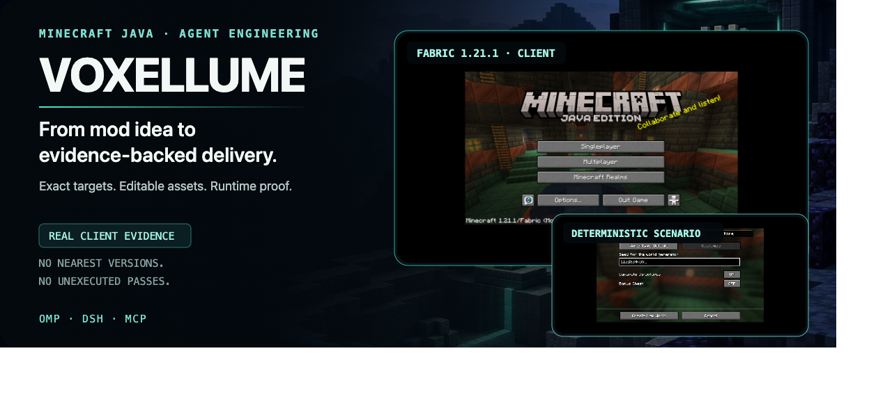

<p align="center">
  <a href="./README.md">English</a> · <a href="./README.ru.md">Русский</a> · <a href="./README.zh-CN.md">简体中文</a>
</p>

<p align="center">
  
</p>

Voxellume is a public, MIT-licensed agent capability for building Minecraft Java mods from an idea to a reviewed, reproducible delivery. It combines exact target packs, editable source and art, secure execution, and evidence-backed verification across OMP, DeepSeek Harness, and MCP.

**Website:** [lukavtz.github.io/voxellume](https://lukavtz.github.io/voxellume/)

## Proof, not promises

The catalog covers all 68 Minecraft/loader cells: **52 candidates, 15 rejected, 1 unsupported, 0 supported**. The current baseline already produces real artifacts and real client evidence. It does not claim blanket compatibility or unexecuted passes.

| Baseline               | Executed evidence                                                                                                                                 | Status                                                                                     |
| ---------------------- | ------------------------------------------------------------------------------------------------------------------------------------------------- | ------------------------------------------------------------------------------------------ |
| **Fabric 1.21.1 r2**   | Clean build, dedicated server, required GameTest, production JAR, real client and deterministic seed capture, pristine packaged-JAR server        | **Candidate** — world/inventory/animation matrix and packaged-JAR client remain incomplete |
| **NeoForge 1.21.1 r2** | Binary-pipeline clean build, two positive GameTests plus a deliberately failing control, dedicated and packaged-JAR servers, real client mod list | **Candidate** — packaged-JAR client and complete visual matrix remain incomplete           |
| **Quilt 1.21.1 r2**    | Clean build, dedicated server, production JAR                                                                                                     | **Candidate** — GameTest unavailable; real-client check timed out                          |
| **Forge 1.21.1 r1**    | Exact MDK and artifact identities checked; decompilation exceeded the mandatory 4 GiB sandbox                                                     | **Rejected** — no production JAR or runtime claim                                          |

Each record includes exact commands, artifact hashes, logs, sandbox limits, and explicit unavailable outcomes.

## One engine, three surfaces

The same `CoreOperations` facade powers all hosts. Model input never supplies a target pack, verification policy, or its own filesystem authority.

```text
minecraft_target_resolve
minecraft_project_inspect
minecraft_project_scaffold
minecraft_assets_validate
minecraft_project_verify
```

Every host returns the same versioned `DomainResult<T>` with stable error codes, retryability, details, and evidence references.

| Surface              | Native contract                                                                        |
| -------------------- | -------------------------------------------------------------------------------------- |
| **OMP**              | Extension tools, conventional skills, agents, and commands                             |
| **DeepSeek Harness** | External Cordis bundle, typed tools, managed verification jobs, shared system prompt   |
| **MCP**              | Official TypeScript server v2 over stdio, strict Zod inputs, bounded structured output |

## How it works

A natural-language request becomes a versioned **ModSpec**: mod identity, exact target revision, features, editable assets, acceptance checks, and delivery settings. Every host calls the same core pipeline, so OMP, Harness, and MCP return equivalent results rather than maintaining separate implementations.

1. **Resolve the exact target.** The resolver matches Minecraft, loader, mappings, JDK, Gradle, and an immutable pack hash. Only a fully qualified `supported` pack can scaffold a new project. `candidate`, `rejected`, and `unsupported` outcomes stop before any project or Git mutation; no nearby version is substituted.
2. **Validate the requested change.** Strict schemas connect every feature to implementation units and independent acceptance checks. Operations address stable feature IDs, not arbitrary file paths or shell commands.
3. **Work in a transaction.** The host grants filesystem roots. Agents edit only a staging copy while per-project locks, base hashes, journaling, cancellation, and last-good rollback protect unrelated files and the canonical project.
4. **Generate editable source and assets.** Java, JSON, PNG, and `.bbmodel` sources remain linked to their runtime exports. The manifest records source/export hashes, generation settings, upstream revisions, licenses, and notices.
5. **Execute under policy.** Verification uses fixed target-pack argument arrays, bounded processes, isolated caches, and sandboxed build/runtime jobs. Model text cannot select executables, grant itself paths, or inherit repository credentials.
6. **Verify in dependency order.** `static → build → server → gameTest → client → productionJar → visual → package`. A failed, cancelled, timed-out, or unavailable stage blocks later claims and is recorded as such; it never becomes a pass.
7. **Deliver with evidence.** A qualified result contains the production JAR, source archive, editable assets, ModSpec, checksums, reproduction commands, and a separate evidence bundle. Commit, push, and PR remain separate trusted-host actions.

## Install and verify

### 1. Install the shared package

Requirements: Node.js `>=24.9.0` and Corepack. The remote installer uses an immutable source archive and verifies its SHA-256 before building. JDK 21 for 1.21.x, JDK 25 for 26.x, and Docker are needed only for their corresponding build/runtime checks.

**Linux and macOS**

```sh
curl -fsSL https://lukavtz.github.io/voxellume/install.sh | sh
```

**Windows PowerShell 5.1+**

```powershell
irm https://lukavtz.github.io/voxellume/install.ps1 | iex
```

For development from a source checkout:

```sh
git clone https://github.com/lukavtz/voxellume.git
cd voxellume
./install.sh
```

The installer installs locked dependencies, builds the exact `voxellume-0.1.0.tgz`, and globally installs the `voxellume-mcp` stdio command. It prints the pnpm global-bin location if that directory is not already on `PATH`.

### 2. Connect the host you use

**OMP 18.17.0** — requires Bun `>=1.4.4`:

```sh
omp plugin link "$PWD" --scope project
omp plugin list --json
```

**DeepSeek Harness 0.2.2-rc.1** — installs the exact tarball into an isolated profile with package scripts disabled:

```sh
dsh plugin --profile voxellume-test add ./voxellume-0.1.0.tgz \
  --ignore-scripts --config.auto-install-peers=false
dsh --profile voxellume-test --dump-config
```

**Native MCP** — run `voxellume-mcp`, or register it as a stdio server in your MCP client:

```json
{
  "mcpServers": {
    "voxellume": {
      "command": "voxellume-mcp"
    }
  }
}
```

No TCP listener, model credential, or hosted service is required for local core operations. Docker, JDKs, and optional asset providers are needed only for their corresponding checks.

### 3. Verify the installation

Run the deterministic gates before delivery:

```sh
corepack pnpm verify
corepack pnpm test
corepack pnpm test:e2e
node scripts/ci/validate-workflows.mjs
```

Latest local evidence: **1073/1073 tests** and **20/20 E2E checks**, including real OMP `18.17.0` and DeepSeek Harness `0.2.2-rc.1` installation. CI runs core and adversarial tests on Ubuntu, macOS, and Windows x64; target cells and supply-chain scans are separate gates.

## Current boundaries

- All 68 target cells have explicit outcomes, but **0 are currently `supported`**; new-project scaffolding therefore remains blocked until a target completes the full qualification matrix.
- Full real-client, packaged-JAR, and visual qualification is still incomplete. Required unavailable checks block `supported`.
- The source facade is disabled because neither candidate passed the correctness/security benchmark.
- Quilt GameTest remains unavailable without a separately qualified workflow.
- This repository is public under MIT. Third-party revisions, licenses, modifications, and notices are recorded under `THIRD_PARTY/` and `support-manifest.json`.

## Deeper reading

- [Product specification](./docs/SPEC.md)
- [Architecture and trust boundaries](./docs/ARCHITECTURE.md)
- [Verification plan](./docs/TEST_PLAN.md)
- [Host contracts](./docs/research/host-contracts.md)
- [E2E scenarios and measured results](./docs/research/e2e-benchmarks.md)
- [CI workflows and OS coverage](./docs/research/ci-workflows.md)
- [Sandboxed visual runtime](./docs/research/visual-qualification-image.md)
- [Pack hashes and qualification links](./support-manifest.json)

## License

[MIT](./LICENSE). Third-party components retain their own licenses and notices.
