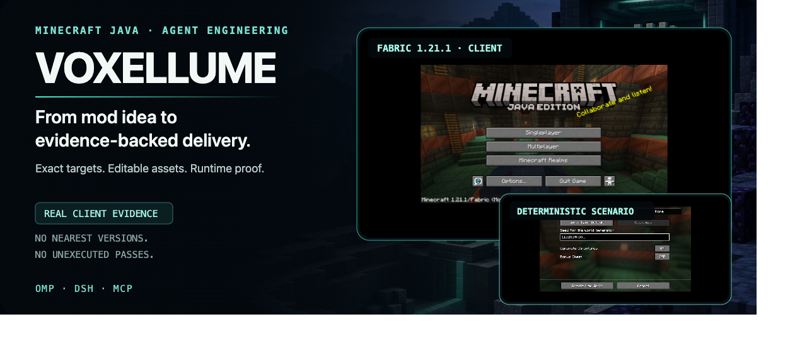
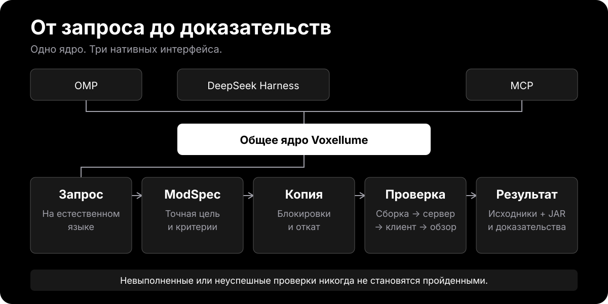

<p align="center">
  <a href="./README.md">English</a> · <a href="./README.ru.md">Русский</a> · <a href="./README.zh-CN.md">简体中文</a>
</p>

<p align="center">
  
</p>

Voxellume — открытый инструмент агента с лицензией MIT для создания модов Minecraft Java: от идеи до проверенного и воспроизводимого результата. Он объединяет точные пакеты целей, редактируемые исходники и графику, безопасное выполнение и проверку с доказательствами в OMP, DeepSeek Harness и MCP.

**Сайт:** [lukavtz.github.io/voxellume/ru](https://lukavtz.github.io/voxellume/ru/)

## Доказательства, а не обещания

Каталог охватывает все 68 сочетаний Minecraft и загрузчика: **52 кандидата, 15 отклонено, 1 не поддерживается, 0 имеют статус `supported`**. Проект уже создаёт реальные артефакты и снимки работающего клиента. Он не заявляет универсальную совместимость и не считает невыполненные проверки пройденными.

| Конфигурация           | Выполненные проверки                                                                                                                                                    | Статус                                                                                          |
| ---------------------- | ----------------------------------------------------------------------------------------------------------------------------------------------------------------------- | ----------------------------------------------------------------------------------------------- |
| **Fabric 1.21.1 r2**   | Чистая сборка, выделенный сервер, обязательный GameTest, итоговый JAR, реальный клиент с фиксированным зерном мира, чистый сервер с собранным JAR                       | **Кандидат** — проверки мира, инвентаря, анимаций и клиента с собранным JAR ещё не завершены    |
| **NeoForge 1.21.1 r2** | Чистая сборка через бинарный конвейер, два успешных GameTest и намеренно падающий контроль, выделенный сервер и сервер с собранным JAR, список модов в реальном клиенте | **Кандидат** — клиент с собранным JAR и полная визуальная матрица ещё не завершены              |
| **Quilt 1.21.1 r2**    | Чистая сборка, выделенный сервер, итоговый JAR                                                                                                                          | **Кандидат** — GameTest недоступен; проверка реального клиента превысила ограничение по времени |
| **Forge 1.21.1 r1**    | Проверены точный MDK и идентичность артефактов; декомпиляция превысила обязательный предел памяти песочницы в 4 ГиБ                                                     | **Отклонён** — итоговый JAR отсутствует, поддержка запуска не заявляется                        |

Каждая запись содержит точные команды, хеши артефактов, журналы, ограничения песочницы и явно отмеченные недоступные результаты.

## Один движок, три интерфейса

Все хосты используют один фасад `CoreOperations`. Входные данные модели никогда не задают пакет цели, политику проверки или собственные права доступа к файловой системе.

```text
minecraft_target_resolve
minecraft_project_inspect
minecraft_project_scaffold
minecraft_assets_validate
minecraft_project_verify
```

Каждый хост возвращает одинаковый версионированный `DomainResult<T>` со стабильными кодами ошибок, признаком допустимости повтора, подробностями и ссылками на доказательства.

| Интерфейс            | Нативный контракт                                                                                                                              |
| -------------------- | ---------------------------------------------------------------------------------------------------------------------------------------------- |
| **OMP**              | Инструменты расширения, стандартные навыки, агенты и команды                                                                                   |
| **DeepSeek Harness** | Внешний пакет Cordis, типизированные инструменты, управляемые задания проверки, общая инструкция                                               |
| **MCP**              | Официальный сервер TypeScript версии 2 через стандартные потоки ввода-вывода, строгие входные схемы Zod и ограниченный структурированный вывод |

## Как это работает

Запрос на естественном языке превращается в версионированный **ModSpec**: идентификаторы мода, точную ревизию цели, функции, редактируемые ресурсы, критерии приёмки и параметры поставки. Все хосты вызывают один основной конвейер, поэтому OMP, Harness и MCP возвращают эквивалентные результаты, а не используют отдельные реализации.

<p align="center">
  
</p>

1. **Точный выбор цели.** Модуль разрешения целей сопоставляет Minecraft, загрузчик, сопоставления имён, JDK, Gradle и неизменяемый хеш пакета. Создавать новый проект разрешено только из полностью проверенного пакета со статусом `supported`. Статусы `candidate`, `rejected` и `unsupported` останавливают работу до изменений проекта или Git; ближайшая версия не подставляется.
2. **Проверка запрошенного изменения.** Строгие схемы связывают каждую функцию с единицами реализации и независимыми критериями приёмки. Операции используют стабильные идентификаторы функций, а не произвольные пути или команды оболочки.
3. **Транзакционная работа.** Хост выдаёт разрешённые корни файловой системы. Агент изменяет только промежуточную копию; блокировки проекта, хеши исходного состояния, журнал, отмена и откат к последнему рабочему состоянию защищают основной проект и посторонние файлы.
4. **Редактируемые исходники и ресурсы.** Файлы Java, JSON, PNG и `.bbmodel` остаются связанными с экспортированными файлами. Манифест записывает хеши источников и экспортов, параметры генерации, исходные ревизии, лицензии и уведомления.
5. **Выполнение по заданной политике.** Проверки используют фиксированные массивы аргументов из пакета цели, ограниченные процессы, изолированные кеши и песочницу для сборки и запуска. Текст модели не может выбрать исполняемый файл, самостоятельно разрешить пути или получить учётные данные репозитория.
6. **Проверка в порядке зависимостей.** `static → build → server → gameTest → client → productionJar → visual → package`. Неуспешный, отменённый, прерванный по времени или недоступный этап блокирует последующие утверждения и сохраняется с настоящим статусом, а не становится успешным.
7. **Поставка с доказательствами.** Проверенный результат содержит итоговый JAR, архив исходников, редактируемые ресурсы, ModSpec, контрольные суммы, команды воспроизведения и отдельный пакет доказательств. Создание коммита, отправка и открытие запроса на слияние остаются отдельными действиями доверенного хоста.

## Установка и проверка

### 1. Установите общий пакет

Требования: Node.js `>=24.9.0` и Corepack. Удалённый установщик использует неизменяемый архив исходников и проверяет его SHA-256 перед сборкой. JDK 21 для 1.21.x, JDK 25 для 26.x и Docker нужны только для соответствующих проверок сборки и запуска.

**Linux и macOS**

```sh
curl -fsSL https://lukavtz.github.io/voxellume/install.sh | sh
```

**Windows PowerShell 5.1 и новее**

```powershell
irm https://lukavtz.github.io/voxellume/install.ps1 | iex
```

Для разработки из исходного кода:

```sh
git clone https://github.com/lukavtz/voxellume.git
cd voxellume
./install.sh
```

Установщик установит зависимости по файлу блокировки, соберёт точный `voxellume-0.1.0.tgz` и глобально установит команду `voxellume-mcp`, работающую через стандартные потоки ввода-вывода. Если каталог глобальных исполняемых файлов pnpm отсутствует в `PATH`, скрипт покажет его расположение.

### 2. Подключите нужный хост

**OMP 18.17.0** — требуется Bun `>=1.4.4`:

```sh
omp plugin link "$PWD" --scope project
omp plugin list --json
```

**DeepSeek Harness 0.2.2-rc.1** — установка точного архива в изолированный профиль с отключёнными установочными сценариями пакета:

```sh
dsh plugin --profile voxellume-test add ./voxellume-0.1.0.tgz \
  --ignore-scripts --config.auto-install-peers=false
dsh --profile voxellume-test --dump-config
```

**Нативный MCP** — запустите `voxellume-mcp` или зарегистрируйте команду как сервер стандартных потоков ввода-вывода в клиенте MCP:

```json
{
  "mcpServers": {
    "voxellume": {
      "command": "voxellume-mcp"
    }
  }
}
```

Для локальных основных операций не нужны сетевой слушатель, учётные данные модели или внешняя служба. Docker, JDK и необязательные поставщики ресурсов требуются только для соответствующих проверок.

### 3. Проверьте установку

Перед передачей результата запустите детерминированные проверки:

```sh
corepack pnpm verify
corepack pnpm test
corepack pnpm test:e2e
node scripts/ci/validate-workflows.mjs
```

Последние локальные результаты: **1080 тестов (1079 пройдено, 1 пропущен для конкретной платформы)** и **20 из 20 сквозных проверок**, включая реальную установку OMP `18.17.0` и DeepSeek Harness `0.2.2-rc.1`. Непрерывная интеграция запускает основные тесты и тесты устойчивости к атакам на Ubuntu, macOS и Windows x64; целевые конфигурации и проверки цепочки поставок выполняются отдельно.

## Текущие ограничения

- Все 68 целевых конфигураций имеют явные результаты, но **0 имеют статус `supported`**; создание новых проектов заблокировано до прохождения целью полной матрицы квалификации.
- Полная квалификация реального клиента, итогового JAR и визуального поведения ещё не завершена. Обязательные недоступные проверки блокируют статус `supported`.
- Фасад исходного кода отключён: ни один кандидат не прошёл проверку корректности и безопасности.
- GameTest для Quilt остаётся недоступным без отдельно проверенного рабочего процесса.
- Репозиторий публичный и распространяется под MIT. Сторонние ревизии, лицензии, изменения и уведомления записаны в `THIRD_PARTY/` и `support-manifest.json`.

## Дополнительные материалы

- [Спецификация продукта](./docs/SPEC.md)
- [Архитектура и границы доверия](./docs/ARCHITECTURE.md)
- [План проверки](./docs/TEST_PLAN.md)
- [Контракты хостов](./docs/research/host-contracts.md)
- [Сквозные сценарии и измеренные результаты](./docs/research/e2e-benchmarks.md)
- [Процессы непрерывной интеграции и покрытие операционных систем](./docs/research/ci-workflows.md)
- [Визуальный запуск в песочнице](./docs/research/visual-qualification-image.md)
- [Хеши пакетов и ссылки на квалификацию](./support-manifest.json)

## Лицензия

[MIT](./LICENSE). Сторонние компоненты сохраняют свои лицензии и уведомления.
