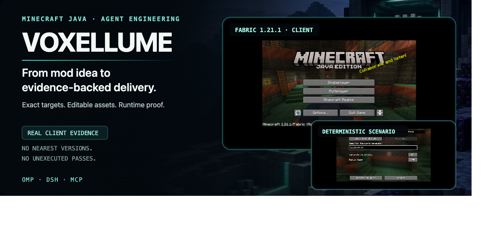

<p align="center">
  <a href="./README.md">English</a> · <a href="./README.ru.md">Русский</a> · <a href="./README.zh-CN.md">简体中文</a>
</p>

<p align="center">
  
</p>

Voxellume 是一个私有智能体能力，用于将 Minecraft Java 模组从想法转化为经过审查、可复现的交付物。它在 OMP、DeepSeek Harness 和 MCP 中统一提供精确目标包、可编辑源码与美术资源、安全执行和证据驱动的验证。

## 证据，而非承诺

当前基线已经能够生成真实工件和真实客户端证据。它不会宣称普遍兼容，也不会把未执行的检查算作通过。

| 基线                   | 已执行的证据                                                                                                   | 状态                                                                    |
| ---------------------- | -------------------------------------------------------------------------------------------------------------- | ----------------------------------------------------------------------- |
| **Fabric 1.21.1 r2**   | 干净构建、专用服务器、必需的 GameTest、生产 JAR、真实客户端与固定 seed 截图、全新 packaged-JAR 服务器          | **候选** — world/inventory/animation 矩阵和 packaged-JAR 客户端尚未完成 |
| **NeoForge 1.21.1 r2** | 二进制流水线干净构建、两个正向 GameTest 及一个故意失败的控制组、专用与 packaged-JAR 服务器、真实客户端模组列表 | **候选** — packaged-JAR 客户端和完整视觉矩阵尚未完成                    |
| **Quilt 1.21.1 r2**    | 干净构建、专用服务器、生产 JAR                                                                                 | **候选** — GameTest 不可用；真实客户端检查超时                          |
| **Forge 1.21.1 r1**    | 已核对精确 MDK 和工件身份；反编译超出强制 4 GiB 沙箱限制                                                       | **已拒绝** — 没有生产 JAR，也不声明运行时支持                           |

每条记录都包含精确命令、工件哈希、日志、沙箱限制和明确的不可用结果。

## 一个引擎，三种宿主

所有宿主都使用同一个 `CoreOperations` 外观。模型输入绝不能提供目标包、验证策略或它自己的文件系统权限。

```text
minecraft_target_resolve
minecraft_project_inspect
minecraft_project_scaffold
minecraft_assets_validate
minecraft_project_verify
```

每个宿主都返回相同且带版本号的 `DomainResult<T>`，其中包含稳定的错误码、是否可重试、详细信息和证据引用。

| 宿主                 | 原生契约                                                              |
| -------------------- | --------------------------------------------------------------------- |
| **OMP**              | 扩展工具、标准 skills、智能体和命令                                   |
| **DeepSeek Harness** | 外部 Cordis bundle、类型化工具、托管验证任务、共享 system prompt      |
| **MCP**              | 官方 TypeScript server v2（stdio）、严格的 Zod 输入、受限的结构化输出 |

## 工作流程

1. **精确解析。** 选择不可变的 Minecraft + loader + mappings + JDK + Gradle 包；否则返回 `unsupported`，绝不用相近版本替代。
2. **安全暂存。** 在授权的事务工作区中操作，支持 last-good 恢复、按项目加锁、受限进程，以及分离的 project/scaffold roots。
3. **保持创作可编辑。** 保留 ModSpec、`.bbmodel`、JSON、PNG、Java 和导出溯源，而不是交付不透明的生成文件。
4. **按顺序验证。** `static → build → server → gameTest → client → productionJar → visual → package`。失败或不可用的阶段绝不会变成通过。
5. **交付证据。** 生产 JAR、源码、可编辑资源、校验和、复现命令，以及独立的认证 evidence bundle。

## 安装与验证

要求：Node.js `>=24.9.0`、pnpm `12.18.0`，以及目标所需的 JDK。沙箱中的构建和运行时检查使用 Docker。

```sh
corepack pnpm install
corepack pnpm build
corepack pnpm pack
```

结果为 `voxellume-0.1.0.tgz`，包含预构建的 JavaScript 和 declarations。

**OMP**

```sh
omp plugin link /absolute/path/to/voxellume
```

**DeepSeek Harness**

```sh
dsh plugin --profile voxellume-test add ./voxellume-0.1.0.tgz
dsh --profile voxellume-test --dump-config
```

**MCP stdio**

```sh
voxellume-mcp
```

交付前运行确定性检查：

```sh
corepack pnpm verify
```

## 当前边界

- 目标包处于候选状态，或具有明确的 rejected/unsupported 结果；**不宣称完整的 1.21–26.3 支持矩阵**。
- 完整的真实客户端、packaged JAR 和视觉验证尚未完成。必需的检查不可用时，将阻止 `supported`。
- Source facade 已禁用，因为两个候选实现都未通过正确性和安全性基准测试。
- 没有经过单独验证的工作流时，Quilt GameTest 仍不可用。
- 本仓库为私有仓库。第三方修订、许可证、修改和声明记录在 `THIRD_PARTY/` 和 `support-manifest.json` 中。

## 深入阅读

- [产品规范](./docs/SPEC.md)
- [架构与信任边界](./docs/ARCHITECTURE.md)
- [验证计划](./docs/TEST_PLAN.md)
- [宿主契约](./docs/research/host-contracts.md)
- [沙箱视觉运行时](./docs/research/visual-qualification-image.md)
- [目标包哈希与验证链接](./support-manifest.json)
