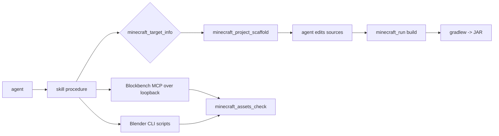

# Voxellume — Architecture

Normative contracts: [PLUGIN-SPEC.md](PLUGIN-SPEC.md). Tool reference:
[TOOLS.md](TOOLS.md).

## 1. Shape

One package, two host adapters, four tools, no server, no evidence pipeline.

```
skills/ agents/ commands/          procedures read by both hosts
targets/pins.json                  version data (68 pins)
templates/fabric-1.21.1/           the one project template
        │
src/adapters/omp, dsh              registration + serialization
        │
src/core/tools/*                   targetInfo, scaffold, run, checkAssets
        │
src/core/{exec,assets,pins}        process control, image validation, data load
src/core/{results,root}.ts         envelope + package root
```

## 2. Layers

**Procedures.** Markdown only. Skills carry ordered agent procedure; they never
execute anything and never restate tool parameters that live in `docs/TOOLS.md`.
OMP discovers `skills/`, `agents/`, and `commands/` by directory convention at the
package root; the DSH adapter receives the same `skills/*/SKILL.md` text through
`systemPrompt.section`.

**Adapters.** The only host-specific code. `src/adapters/shared.ts` builds the four
tool closures once; `omp/index.ts` registers them with `approval` classes;
`dsh/index.ts` wraps them with `defineTool` (its `output.render` is mandatory) and
registers the prompt section. Adapters translate host arguments, nothing else.

The package is both an OMP plugin and a DSH bundle. `package.json` declares a `pi`
field pointing OMP at `dist/adapters/omp/index.js`, and a `dsh.bundle.patch` field
pointing DSH at `cordis.patch.yml`, whose single `insert` row imports this package
by name and resolves through the root `"."` export to `dist/adapters/dsh/index.js`.
The same four tools back both entries; neither host gets its own copy of the logic.

**Tools.** `src/core/tools/*` holds the real logic. Each tool is a pure-ish async
function: parameters in, `ToolResult<T>` out, no host types, no globals, no logging
side effects beyond the run log. Tools validate before they act and report only what
they observed.

**Execution.** `src/core/exec/run-process.ts` is the single place a process is
spawned. It owns argv construction, environment scrubbing, output caps, log files,
timeouts, abort handling, and process-tree termination. Nothing else in the tree may
call `spawn`, `exec`, or `execFile` for a build.

**Assets.** `src/core/assets/png.ts`, `src/core/assets/visual-diff.ts`, and
`src/core/assets/lang.ts` are pure decoders and comparators. They never read from
disk; `assets-check.ts` does the bounded reads.

**Data.** `targets/pins.json` is the only source of target versions; it is maintained
by hand.

## 3. Invariants

1. No process runs without an allowlisted argv array and `shell: false`.
2. No path is used before `realpath` + containment check against its declared root.
3. No tool reports `ok` for a fact it did not observe.
4. No host-specific type reaches `src/core/**`.
5. No module under `src/core/**` imports a host package.
6. `dist/` is a build artifact; the shipped package contains no TypeScript source.
7. `scripts/check-structure.mjs` fails the build when a retired directory returns.

## 4. Data flow



Verification is a procedure, not a subsystem: a change is proven when
`minecraft_run` returns an observed exit code and the expected artifact exists in the
log or on disk.

## 5. Non-goals

- No evidence manifests, transaction journals, staging roots, or rollback.
- No target status catalog, support labels, or qualification records.
- No bundled MCP server, no site, no installer, no release automation beyond CI.
- No runtime dependency on Blockbench or Blender; both are optional and documented.

## 6. Testing

| Layer                         | Test kind                   | Location                                       |
| ----------------------------- | --------------------------- | ---------------------------------------------- |
| envelope, pins                | unit                        | `tests/unit/{results,pins}.test.ts`            |
| scaffold substitution         | unit on a minimal fixture   | `tests/unit/scaffold.test.ts`                  |
| scaffold on the real template | integration                 | `tests/integration/scaffold-template.test.ts`  |
| run process control           | unit with stub wrappers     | `tests/unit/run.test.ts`                       |
| assets                        | unit with generated PNGs    | `tests/unit/{assets-check,png-visual}.test.ts` |
| host adapters                 | integration with fake hosts | `tests/integration/{omp,dsh}-adapter.test.ts`  |
| docs links                    | integration                 | `tests/integration/capability-docs.test.ts`    |
| real Fabric build + server    | live, opt-in                | `tests/live/fabric-build.test.ts`              |

`pnpm verify` runs format, lint, typecheck, structure, unit, and integration. The
live suite runs in CI with JDK 21 and network access, and locally with
`VOXELLUME_LIVE=1`.
