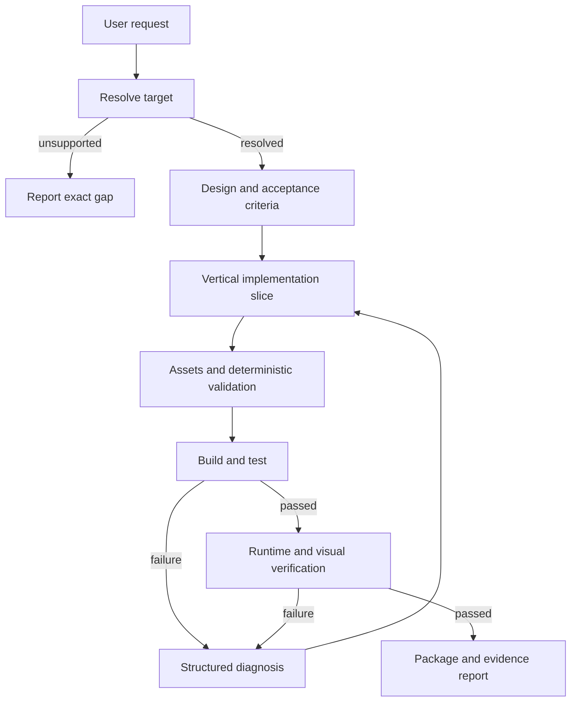

# Voxellume — Architecture

Status: approved
Specification: [SPEC.md](SPEC.md)

## 1. Architectural drivers

- One installable product must serve OMP and DeepSeek Harness.
- Creative agent behavior must be separated from deterministic verification.
- Minecraft and loader differences must be localized in target packs.
- Build and game execution cross a trust boundary.
- OMP and Harness have different tool schemas, result contracts, lifecycles, and prompt mechanisms.
- The same core must remain usable through optional MCP without duplicating behavior.

## 2. Decisions

### ADR-001: One package, two native adapters, one shared core

Use one TypeScript package with an OMP extension entry and a DeepSeek Harness Cordis bundle entry. Keep domain operations independent of both hosts.

Reason: two real host adapters justify the shared-core seam. Separate repositories would duplicate contracts, skills, target packs, fixtures, and verification logic.

### ADR-002: Skills guide; tools execute and verify

Skills contain ordered agent procedures and links to versioned references. Tools own filesystem, process, validation, and evidence-producing behavior.

OMP discovers conventional `skills/`, `agents/`, `commands/`, and extension modules. Harness exposes the same procedures through its prompt/tool mechanisms and native bundle lifecycle. The Markdown skill bodies remain the single source of workflow truth.

### ADR-003: Versioned target packs replace a universal template

Every target pack owns its exact toolchain contract, templates, docs pointers, fixtures, and verification support. Core rejects an unresolved or unsupported target.

Reason: registries, mappings, Java, Gradle, data formats, and test APIs vary by Minecraft and loader. A generic scaffold would silently generate incompatible mods.

### ADR-004: Few deep model-facing operations

Prefer a small set of operations with structured results:

- `minecraft_target_resolve`
- `minecraft_project_scaffold`
- `minecraft_assets_validate`
- `minecraft_project_verify`
- `minecraft_project_inspect`

Each operation hides target-specific details behind one contract. Ordinary source editing remains the host agent's existing file-tool responsibility.

### ADR-005: Verification is a staged evidence pipeline

Verification returns a structured report containing requested checks, executed checks, outcomes, diagnostics, artifact paths, and explicit unsupported/unavailable states. A check that did not run cannot be reported as passed.

The pipeline is deterministic and target-pack driven. The agent may diagnose and repair failures, but cannot edit the evidence.

### ADR-006: Native execution first, optional MCP transport second

OMP and Harness adapters call core operations directly. MCP, when enabled, is another adapter over the same operations for other MCP clients and isolated process execution.

MCP is not used for prompt text, static skills, or ordinary source editing already provided by the host.

### ADR-007: Generated projects are untrusted executable input

All project operations run inside an authorized root. Process execution uses argument arrays, explicit working directories, cancellation, deadlines, bounded output, and host policy. Network-enabled build steps and game launches are visible in the verification report.

### ADR-008: Typed editable assets behind one execution facade

`TextureSpec` and `AnimationSpec` are versioned, target-bound inputs to asset generation, not free-form tool requests. They link stable asset/clip/state IDs, editable sources, runtime exports, deterministic settings, provenance, and acceptance rules. Texture sources are `.grid` or layered `.mcpx`; models and bone animations use `.bbmodel`. Animated-texture delivery is a vertical PNG strip plus sibling `.png.mcmeta`. An atlas is only an editable or diagnostic sheet.

Pinned `smile-minecraft/mc-asset` `v0.5.0` (`bedf67229ab0fdf304f6d40bc0000a27bd05e880`) requires both entry-point SHA-256 `2a82e605666ee0200dd63b1b3fa6e7774b4c69bd446e2f84cb311dbefc21b86f` and deterministic full-`dist` SHA-256 `7bd753bc61d47d7317d17356366f6deae9b9bd48eee69a3899c8580a676844c3` (exact value from implementation constant). It runs as an external process for deterministic pixel cleanup, seeded generation, tiling, frame strips, and style/pack checks. The model sees allowlisted core operations only, never raw CLI paths or raw mc-asset MCP tools. The shared execution supervisor supplies fixed executable/argument arrays with `shell:false`, authorized-root and realpath checks, mutation-time symlink/path-swap and hardlink protection, pre-read/decode/output/log quotas, staging and journaled publication of the complete output set, process-group cancellation, offline/scrubbed environments, and hash evidence. This facade is required because the completed pilot demonstrated parent/absolute/symlink-parent output escapes, no effective general pre-read byte cap, and non-transactional multi-artifact writes.

`jasonjgardner/blockbench-mcp-plugin` `1.10.1` (`97a8a80d3a37bf95c5e136d93d2c7da399fff753`) remains the sole external Blockbench engine, with restricted roots, revisions/atomic writes, `risky_eval=off`, and loopback-only desktop service. Reuse only the MIT rig/template, cycle-generator, evaluated-animation analyzer, orientation, model-check, and deterministic paint/UV methods from `sosadly/blockbench-mcp` `0.3.1` (`028cdd76589de2e2cea51bfd79495b50a3c7d1d2`) behind Voxellume's typed API and notices. Replace every random path with versioned seeded RNG. Do not install its server, MCP bridge, `execute_script`, or plugin installer.

Blender uses reviewed fixed scripts only for optional loop/QA/contact-sheet analysis; it is not a Minecraft exporter. Mosaicary `0.1.4` (`08bdba5252a378cf8e2111b0c2cb27cec4ea15ba`) is a conditional, pinned, local, network-denied glTF/Blender ingress pending conversion and runtime pilots. Java Block/Item models never acquire bone animation through this route.

### ADR-009: Decompose transactions behind two public entry points

`src/core/spec/transactions.ts` exposes only `buildCandidate` and `commitCandidate`. `transaction-types.ts` owns their shared contracts; `transactions/` contains focused staging, commit, apply, recovery, journal, ownership, lock, path, tree, and state modules. Dependencies flow from the public facade to stage/commit orchestration, then to apply/recovery and journal/ownership helpers, down to path/tree/lock/state primitives. Internal modules are not a second public API.

A private `WeakMap` binds the verified candidate object to a deep-frozen snapshot and its complete staging-tree hash. Commit requires that binding, rejects candidate digest changes, restores the snapshot, and rechecks both canonical base and complete staging trees. New-project commit revalidates the complete staging tree after `beforeDirectorySwap` and immediately before rename. Ownership covers declared implementation, asset, artifact, and ModSpec paths, including staged deletions; unrelated user files are not apply targets. A lock keyed by the canonical project path serializes staging and commit. Journals are authenticated with HMAC-SHA256 before recovery, then strictly validated for identity, base hash, owned apply prefix, matching backups, and owned temporary files. Recovery restores backups in reverse order and reports conflicts as `recovery_required`. Cancellation observed after the committed transition enters recovery instead of returning false success.

Journals remain in the transaction workspace at `<workspaceRoot>/<transactionId>/journal.json`; no external journal location is implemented. Their persistent random 32-byte HMAC key is stored at `~/.config/voxellume/journal-secret`, with a `0700` parent directory and a `0600`, single-link regular file owned by the current UID. Pathname validation catches observed symlink and identity changes, but does not eliminate parent-directory swap TOCTOU between checks and mutation. The §3 directory-handle path supervisor must anchor operations to opened parent directories before complete race resistance can be claimed.

### ADR-010: Native directory handles and supervised execution fail closed

Only the trusted host grants an authorized root; copying its public fields cannot mint authority. Project roots are read-only through this API, and only transaction-staging roots permit writes. On macOS and Linux, `fs-at.ts` pins the root and every parent with per-component libc `openat`/`O_NOFOLLOW` traversal and uses `mkdirat`, `unlinkat`, and no-replace `renameat2`/`renameatx_np` for mutation. On Windows, `fs-at-win32.ts` uses NTDLL `NtCreateFile` relative to `RootDirectory`, one component per call, `FILE_OPEN_REPARSE_POINT` plus post-open reparse/type checks, and `FileRenameInformationEx`/`FileDispositionInformationEx`. Hard-linked mutation targets and unsupported filesystem semantics are rejected. Windows has no documented directory-handle flush, so file flush is not reported as directory durability.

Koffi is pinned to `3.3.7`; `pnpm.ignoredBuiltDependencies` blocks its installer. Only the matching `@koromix/koffi-<os>-<arch>` prebuilt may load. Missing prebuilts, symbols, or ABI layout checks return `execution.native_dirfd_unavailable`; there is no source-build or pathname-based `fs` mutation fallback. The Windows x64/ARM64 NTDLL and process implementations are present but have not been runtime-verified, so Windows is not yet a qualified platform.

Verification accepts only fixed `./gradlew --no-daemon <allowlisted-task>` argv with `shell:false`. POSIX runs use a detached process group and signal the negative PID; Windows creates the process suspended, assigns a Job Object before `ResumeThread`, and uses `TerminateJobObject` plus `KILL_ON_JOB_CLOSE`, never `taskkill /T`. Job setup failure is `unavailable`, never a pass. Limits are 15-minute builds, 10-minute server/client runs, 16 MiB captured output, 2 GiB evidence, one Gradle process per project, and container budgets of 2 CPUs, 4 GiB memory, and 512 PIDs. The environment is rebuilt from an allowlist with isolated home, Gradle cache, and temporary directories. Docker currently returns `backend_unavailable`; host execution must not be described as container or network isolation. EULA and network approvals are exact, persisted separately in mode-`0600` `approvals.json`, and never silently granted.

Transaction journals and evidence bundles use domain-separated HMAC-SHA256 over canonical JSON with the persistent mode-`0600` secret. Evidence `SHA256SUMS` separately covers every stored log, artifact, and manifest byte; `readEvidence` verifies both the checksums and manifest MAC. Typed review subjects bind source/export, production-JAR/client-scenario, and human design-review evidence. Stand-in or rejected reviewers cannot pass the human gate. Authentication does not replace immutable external evidence custody.

## 3. Repository layout

```text
.
├── package.json
├── cordis.patch.yml
├── tsconfig.json
├── src/
│   ├── core/
│   │   ├── targets/
│   │   ├── projects/
│   │   ├── assets/
│   │   ├── execution/
│   │   ├── verification/
│   │   └── spec/
│   │       ├── transactions.ts
│   │       ├── transaction-types.ts
│   │       └── transactions/
│   │           ├── state.ts
│   │           ├── stage.ts
│   │           ├── ownership.ts
│   │           ├── paths.ts
│   │           ├── lock.ts
│   │           ├── tree.ts
│   │           ├── journal.ts
│   │           ├── apply.ts
│   │           ├── commit.ts
│   │           └── recovery.ts
│   ├── adapters/
│   │   ├── omp/
│   │   ├── dsh/
│   │   └── mcp/
│   └── shared/
├── skills/
│   ├── minecraft-design/
│   ├── minecraft-implementation/
│   ├── minecraft-assets/
│   ├── minecraft-verification/
│   └── minecraft-release/
├── agents/
├── commands/
├── target-packs/
│   └── <edition>/<loader>/<minecraft-version>/
├── fixtures/
│   ├── target-resolution/
│   ├── projects/
│   └── verification/
├── tests/
│   ├── helpers/
│   │   └── transaction-fixture.ts
│   ├── unit/
│   │   ├── transactions.test.ts
│   │   ├── transaction-commit.test.ts
│   │   ├── transaction-recovery.test.ts
│   │   └── transaction-security.test.ts
│   ├── integration/
│   └── host-contract/
├── docs/
│   ├── research/
│   ├── SPEC.md
│   └── ARCHITECTURE.md
└── .github/
    └── workflows/
```

`src/core/execution/paths.ts` uses opened root and parent-directory handles for lookup, open, rename, and unlink operations. The transaction implementation still has separate pathname checks with a parent-swap TOCTOU window; the execution supervisor's race resistance must not be attributed to those legacy transaction paths. Windows directory-handle behavior remains unverified until the required native CI probes pass.

`src/shared` is limited to types used by more than one module. It must not become a dumping ground for unrelated helpers.

## 4. Core interfaces

These are proposed test seams, not implementation commitments. Their exact signatures are fixed before the first TDD cycle.

### Target resolution

Input: requested edition, Minecraft version, loader, and optional existing project root.

Output: a fully resolved target or a structured unsupported/ambiguous result. No filesystem mutation.

### Project inspection

Input: authorized project root.

Output: detected target, source layout, declared dependencies, available verification tasks, and target mismatches. No project mutation.

### Scaffolding

Input: authorized destination, resolved target, validated mod metadata, and feature selection.

Output: created files and detected conflicts. Existing files are never overwritten implicitly.

### Asset validation

Input: authorized project root, selected target, `TextureSpec`/`AnimationSpec` revisions, and their source/export manifests.

Output: structured findings with asset path, stable rule ID, `checkClass=source|browser|design_review`, severity, and source location where available. `browser` explicitly names the rendered surface; only `surface=minecraft_client` closes an in-game gate. Blockbench and Blender results remain source/preview evidence and cannot substitute for the production-JAR client or independent design review.

Asset provenance links each runtime hash to its spec, editable-source hash, immutable concept/reference, provider and cleanup parameters, seeded-RNG algorithm/seed derivation, tool revisions, conversion reports, target revision, scenario IDs, and approval revision. Any source, palette, workflow, export, or converter change invalidates the previous approval.

### Verification

Input: authorized project root, resolved target, requested verification profile, cancellation signal, and execution policy.

Output: ordered check results and artifact references. Domain failures are data; infrastructure failures use explicit errors.

## 5. Target-pack contract

A target pack contains:

```text
target.json
README.md
docs.json
templates/
fixtures/
verification.json
```

`target.json` identifies exact versions and supported capabilities. `docs.json` points to first-party documentation and its revision. `verification.json` selects allowed build/test scenarios; it does not contain arbitrary shell strings supplied by the model.

Templates are reviewed source, not runtime-generated string concatenation. Dependencies and wrapper artifacts use locked versions and integrity metadata where supported.

## 6. Runtime flow



## 7. Host adaptation

### OMP

- `package.json#omp.extensions` declares the native extension.
- `ExtensionAPI.registerTool` exposes core operations with host schemas.
- Conventional directories provide skills, agents, and commands.
- Host cancellation and approval policy reach core execution.
- Tool results use OMP content and structured details contracts.

### DeepSeek Harness

- `package.json#dsh.bundle.patch` declares the bundle layer.
- `cordis.patch.yml` mounts the native plugin.
- `defineTool` exposes typed operations and canonical JSON outputs.
- Registrations follow Cordis effect disposal.
- `exec.signal` reaches every long-running operation.
- Renderers translate structured results without changing domain values.

### MCP

- Stdio only by default.
- No authentication assumption for arbitrary remote exposure.
- Same input validation and execution policy as native adapters.
- No duplicate domain implementation.

## 8. Verification levels

| Level              | Runs                       | Required evidence                                                                                                 |
| ------------------ | -------------------------- | ----------------------------------------------------------------------------------------------------------------- |
| Static             | Every change               | Format, lint, types, dependency/security checks                                                                   |
| Unit               | Every TDD slice            | Public-interface behavior and failure cases                                                                       |
| Host contract      | Adapter changes            | OMP and Harness calls, results, cancellation                                                                      |
| Target integration | Target or template changes | Real clean Gradle build and resource validation                                                                   |
| Runtime            | Supported target changes   | Server/client/game-test scenarios                                                                                 |
| Visual             | Asset or UI changes        | Source gates, production-JAR Minecraft states/captures, and independent design review; previews are supplementary |
| Release            | Every PR                   | Clean checkout, full required matrix, package inspection                                                          |

CI separates fast deterministic checks from long Java/game jobs. Required support status depends on the real integration matrix, not mocked success.

## 9. Security invariants

- A model-supplied path cannot escape the authorized project root.
- A model cannot supply an executable or arbitrary command line to core verification.
- Cancellation terminates child processes and waits for cleanup.
- Output and artifact collection have explicit size limits.
- Secrets are neither inherited unnecessarily nor included in reports.
- Unsupported operations fail closed.
- Generated evidence is read-only to the agent workflow.

## 10. Open decisions

The specification's open product decisions determine the first release matrix. No target is marked supported until its real toolchain and verification fixtures pass.
