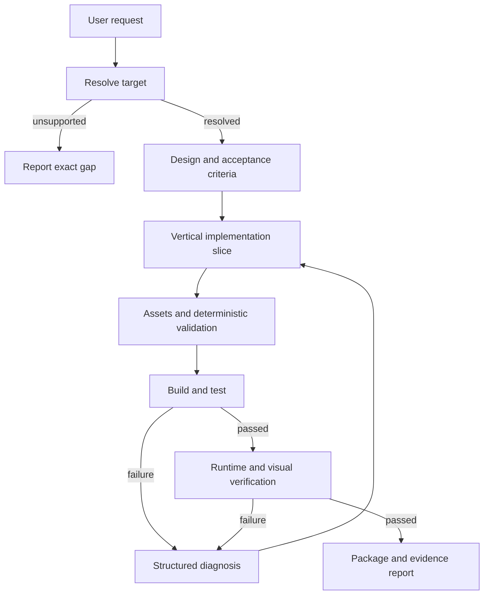

# Voxellume — Architecture

Status: approved
Specification: [SPEC.md](SPEC.md)

## 1. Architectural drivers

- One installable product must serve OMP and DeepSeek Harness.
- Creative agent behavior must be separated from deterministic verification.
- Minecraft and loader differences must be localized in target packs.
- Build and game execution cross a trust boundary.
- OMP and Harness have different tool schemas, result contracts, lifecycles, and prompt mechanisms.
- The same core must remain usable through optional MCP without duplicating behavior.

## 2. Decisions

### ADR-001: One package, two native adapters, one shared core

Use one TypeScript package with an OMP extension entry and a DeepSeek Harness Cordis bundle entry. Keep domain operations independent of both hosts.

Reason: two real host adapters justify the shared-core seam. Separate repositories would duplicate contracts, skills, target packs, fixtures, and verification logic.

### ADR-002: Skills guide; tools execute and verify

Skills contain ordered agent procedures and links to versioned references. Tools own filesystem, process, validation, and evidence-producing behavior.

OMP discovers conventional `skills/`, `agents/`, `commands/`, and extension modules. Harness exposes the same procedures through its prompt/tool mechanisms and native bundle lifecycle. The Markdown skill bodies remain the single source of workflow truth.

### ADR-003: Versioned target packs replace a universal template

Every target pack owns its exact toolchain contract, templates, docs pointers, fixtures, and verification support. Core rejects an unresolved or unsupported target.

Reason: registries, mappings, Java, Gradle, data formats, and test APIs vary by Minecraft and loader. A generic scaffold would silently generate incompatible mods.

### ADR-004: Few deep model-facing operations

Prefer a small set of operations with structured results:

- `minecraft_target_resolve`
- `minecraft_project_scaffold`
- `minecraft_assets_validate`
- `minecraft_project_verify`
- `minecraft_project_inspect`

Each operation hides target-specific details behind one contract. Ordinary source editing remains the host agent's existing file-tool responsibility.

### ADR-005: Verification is a staged evidence pipeline

Verification returns a structured report containing requested checks, executed checks, outcomes, diagnostics, artifact paths, and explicit unsupported/unavailable states. A check that did not run cannot be reported as passed.

The pipeline is deterministic and target-pack driven. The agent may diagnose and repair failures, but cannot edit the evidence.

### ADR-006: Native execution first, optional MCP transport second

OMP and Harness adapters call core operations directly. MCP, when enabled, is another adapter over the same operations for other MCP clients and isolated process execution.

MCP is not used for prompt text, static skills, or ordinary source editing already provided by the host.

### ADR-007: Generated projects are untrusted executable input

All project operations run inside an authorized root. Process execution uses argument arrays, explicit working directories, cancellation, deadlines, bounded output, and host policy. Network-enabled build steps and game launches are visible in the verification report.

## 3. Repository layout

```text
.
├── package.json
├── cordis.patch.yml
├── tsconfig.json
├── src/
│   ├── core/
│   │   ├── targets/
│   │   ├── projects/
│   │   ├── assets/
│   │   ├── execution/
│   │   └── verification/
│   ├── adapters/
│   │   ├── omp/
│   │   ├── dsh/
│   │   └── mcp/
│   └── shared/
├── skills/
│   ├── minecraft-design/
│   ├── minecraft-implementation/
│   ├── minecraft-assets/
│   ├── minecraft-verification/
│   └── minecraft-release/
├── agents/
├── commands/
├── target-packs/
│   └── <edition>/<loader>/<minecraft-version>/
├── fixtures/
│   ├── target-resolution/
│   ├── projects/
│   └── verification/
├── tests/
│   ├── unit/
│   ├── integration/
│   └── host-contract/
├── docs/
│   ├── research/
│   ├── SPEC.md
│   └── ARCHITECTURE.md
└── .github/
    └── workflows/
```

`src/shared` is limited to types used by more than one module. It must not become a dumping ground for unrelated helpers.

## 4. Core interfaces

These are proposed test seams, not implementation commitments. Their exact signatures are fixed before the first TDD cycle.

### Target resolution

Input: requested edition, Minecraft version, loader, and optional existing project root.

Output: a fully resolved target or a structured unsupported/ambiguous result. No filesystem mutation.

### Project inspection

Input: authorized project root.

Output: detected target, source layout, declared dependencies, available verification tasks, and target mismatches. No project mutation.

### Scaffolding

Input: authorized destination, resolved target, validated mod metadata, and feature selection.

Output: created files and detected conflicts. Existing files are never overwritten implicitly.

### Asset validation

Input: authorized project root and selected target.

Output: structured findings with asset path, rule, severity, and source location where available.

### Verification

Input: authorized project root, resolved target, requested verification profile, cancellation signal, and execution policy.

Output: ordered check results and artifact references. Domain failures are data; infrastructure failures use explicit errors.

## 5. Target-pack contract

A target pack contains:

```text
target.json
README.md
docs.json
templates/
fixtures/
verification.json
```

`target.json` identifies exact versions and supported capabilities. `docs.json` points to first-party documentation and its revision. `verification.json` selects allowed build/test scenarios; it does not contain arbitrary shell strings supplied by the model.

Templates are reviewed source, not runtime-generated string concatenation. Dependencies and wrapper artifacts use locked versions and integrity metadata where supported.

## 6. Runtime flow



## 7. Host adaptation

### OMP

- `package.json#omp.extensions` declares the native extension.
- `ExtensionAPI.registerTool` exposes core operations with host schemas.
- Conventional directories provide skills, agents, and commands.
- Host cancellation and approval policy reach core execution.
- Tool results use OMP content and structured details contracts.

### DeepSeek Harness

- `package.json#dsh.bundle.patch` declares the bundle layer.
- `cordis.patch.yml` mounts the native plugin.
- `defineTool` exposes typed operations and canonical JSON outputs.
- Registrations follow Cordis effect disposal.
- `exec.signal` reaches every long-running operation.
- Renderers translate structured results without changing domain values.

### MCP

- Stdio only by default.
- No authentication assumption for arbitrary remote exposure.
- Same input validation and execution policy as native adapters.
- No duplicate domain implementation.

## 8. Verification levels

| Level              | Runs                       | Required evidence                                        |
| ------------------ | -------------------------- | -------------------------------------------------------- |
| Static             | Every change               | Format, lint, types, dependency/security checks          |
| Unit               | Every TDD slice            | Public-interface behavior and failure cases              |
| Host contract      | Adapter changes            | OMP and Harness calls, results, cancellation             |
| Target integration | Target or template changes | Real clean Gradle build and resource validation          |
| Runtime            | Supported target changes   | Server/client/game-test scenarios                        |
| Visual             | Asset or UI changes        | Actual model/game surface inspection                     |
| Release            | Every PR                   | Clean checkout, full required matrix, package inspection |

CI separates fast deterministic checks from long Java/game jobs. Required support status depends on the real integration matrix, not mocked success.

## 9. Security invariants

- A model-supplied path cannot escape the authorized project root.
- A model cannot supply an executable or arbitrary command line to core verification.
- Cancellation terminates child processes and waits for cleanup.
- Output and artifact collection have explicit size limits.
- Secrets are neither inherited unnecessarily nor included in reports.
- Unsupported operations fail closed.
- Generated evidence is read-only to the agent workflow.

## 10. Open decisions

The specification's open product decisions determine the first release matrix. No target is marked supported until its real toolchain and verification fixtures pass.
